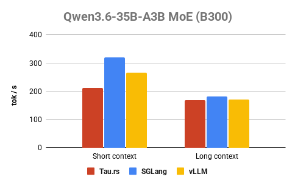
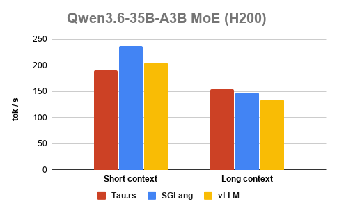
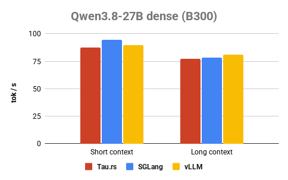
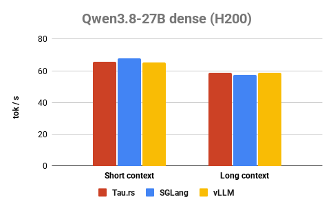

# Introducing Tau.rs: a lightweight and performant Rust inference engine

*Version 0.1.0 — engineering preview*

## 1. A Rust inference engine, developed with AI

We are introducing Tau.rs, pronounced “Taurus”: a Rust inference engine for
running local language models. This first release is an engineering preview of
a focused runtime with native CUDA kernels and an OpenAI-compatible Chat
Completions API.

`Tau.rs` (its compiled binary `tau-server`) supports CPU and CUDA execution
for supported models, providing an alternative to mainstream `SGLang` and
`vLLM` inference engines. GPU inference requires a compatible NVIDIA driver;
building from source also requires the CUDA toolkit.

Tau.rs has been developed with human-AI codesign from the beginning. Most of its own
implementation has been written by AI coding agents, with human expertise
currently guiding research, architecture, optimization ideas, strategies, priorities,
code quality, review, and validation. Agents contribute implementation, tests,
refactoring, troubleshooting, benchmarking and optimization experiments. Tau.rs is
both an AI inference engine and a practical experiment in building ML systems software
by AI itself. The north star is to expand the role of AI toward building its own reasoning
engine eventually.

Correctness is part of that process. On tested model and hardware configurations,
we validate numerical alignment against SGLang and use regression tests to check
generation state, cached execution, request resets and GPU execution paths. Our 
performance target is comparability with SGLang and vLLM on the workloads we
support, while keeping the implementation lightweight, understandable, and with
clean software architecture. We benchmarked against SGLang and vLLM serving latest
dense and MoE models on B300 and H200 GPUs.

[Using `vllm bench serve` with short context (128 tokens) and long context (1024 tokens).]

## 2. Why we chose Rust

An inference engine is one of the most performance-sensitive layer in the reasoning
stack. Performance depends on careful memory use and execution design.
Reliability depends on keeping those resources
and their lifetimes understandable as the system evolves.

We believe Rust is an excellent fit for that work. Its ownership model and type
system help make resource lifetimes and interfaces explicit, while native
compilation gives us control over allocations and execution overhead. We can
express the host runtime in Rust and use CUDA kernels where GPU execution
benefits from specialized implementations.

Rust also supports the modular language structure, strong type system, and modern
syntax we want. Components in inference engine like model loading, model
construction, prefill, decode, optimizations, generation, chat
handling, and request serving have clear logical boundaries, and owners, so
changes can be evaluated within the appropriate logical bubble. 
This gives both human contributors and AI agents smaller, clearer pieces of the
engine to work on with clear logical contracts. Those are the qualities we
want in an inference engine that can grow into reliable production use.

## 3. An engineering preview for evaluation and feedback

Version 0.1.0 is our first public cut. It serves as a proof of concept for this
runtime design and for the co-design (evolving toward AI-design) development
process behind it. We are sharing it so interested engineers and teams can try
it on real workloads, inspect the code and help us understand where it is useful
and where it needs refinement.

The first release has focused model and hardware coverage. The README documents
supported configurations, installation requirements and current limitations.
It also provides a minimal example for starting `tau-server` and sending a chat
completion request.

If you try Tau.rs, we would like to hear about your experience: whether setup was
straightforward, how it behaved on your model and hardware, and what would make
it easier to use or integrate. Reproducible correctness and performance reports
are especially helpful; include the model, device, configuration and request
that produced the result.

Tau.rs is available under the Apache-2.0 license. You can find the source,
quickstart and release notes in the
[project repository](https://github.com/taurs-ai/tau.rs), and share feedback through
[GitHub issues](https://github.com/taurs-ai/tau.rs/issues).

Feedback from this engineering preview will help shape what comes next.